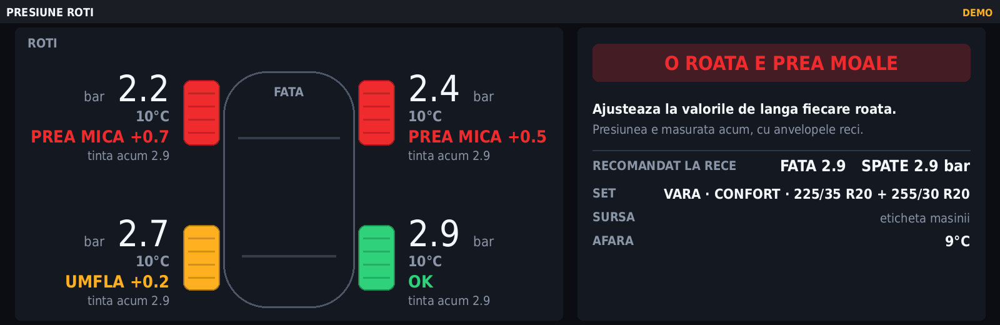
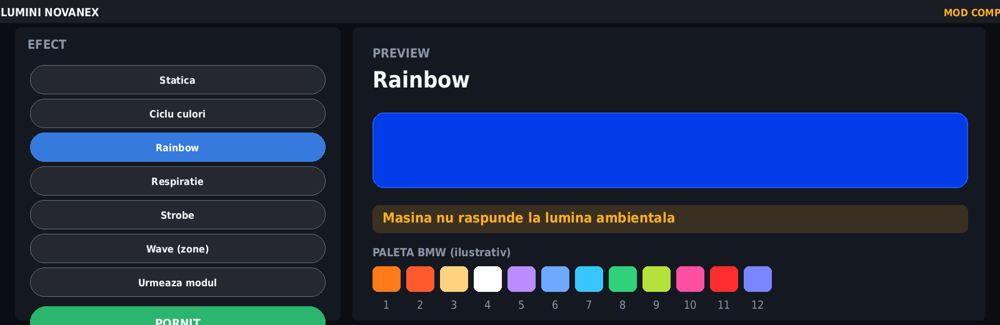

# NOVANEX — aplicații pentru BMW iDrive 7 (MGU)

Aplicațiile NOVANEX pentru unitatea iDrive 7 (MGU), instalabile din [MGU Store](https://github.com/robertnisipeanu/mgu-store).

| Aplicație | Ce face |
|---|---|
| [**Presiune Roti**](apps/novanex_tyres/README.md) | Presiunea și temperatura în fiecare roată. Arată cât să umfli sau să scoți, corectat după cât de calde sunt anvelopele, pentru setul de vară sau de iarnă. |
| [**Lumini NOVANEX**](apps/novanex_ambient/README.md) | Efecte pentru lumina ambientală: statică, ciclu culori, rainbow, respirație, strobe, wave și urmează modul de condus. |




## Instalare

1. Ai nevoie de MGU Store pe unitate. Pașii sunt în [mgu-store](https://github.com/robertnisipeanu/mgu-store#install).
2. În Store, deschide Settings → **Add source** și scrie `techechanter/idrive7-apps-novanex`. Alege branch-ul `main`.
3. Instalează „Presiune Roti" din Store. Unitatea o compilează singură. Store-ul instalează înainte și randarea GPU și controlul din butonul iDrive (`idrive7-renderd`, `mgu-inputgate`), de care aplicația are nevoie.

## Dezvoltare

- `apps/<id>/` conține câte o aplicație: `app.json`, `main.js` și modulele ei. Orice folder nou de aici apare singur în Store, prin `mgu-repo.json`.
- `tools/novanex_tyres/` conține testele, scriptul care preia presiunile de pe site și uneltele pentru previzualizare.
- `kit/` e kit-ul pentru construit aplicații: runtime, build, previzualizare și randarea GPU. Ghidul complet e în [idrive7-apps](https://github.com/cauliflowermossgrape/idrive7-apps#6-writing-your-own-app).

```bash
node tools/novanex_tyres/test_advisor.js
python3 kit/tools/build.py --preview-only novanex_tyres && node kit/tools/preview.js dist/novanex_tyres preview wait=8
```

## Licență și proveniență

Repo-ul e un fork al [cauliflowermossgrape/idrive7-apps](https://github.com/cauliflowermossgrape/idrive7-apps). Kit-ul din `kit/` vine de acolo și se află sub licența MIT (`LICENSE`), iar părțile terțe din `third_party/` își păstrează licențele lor. Aplicațiile din `apps/` sunt ale NOVANEX. Proiectul nu e afiliat cu BMW AG.
